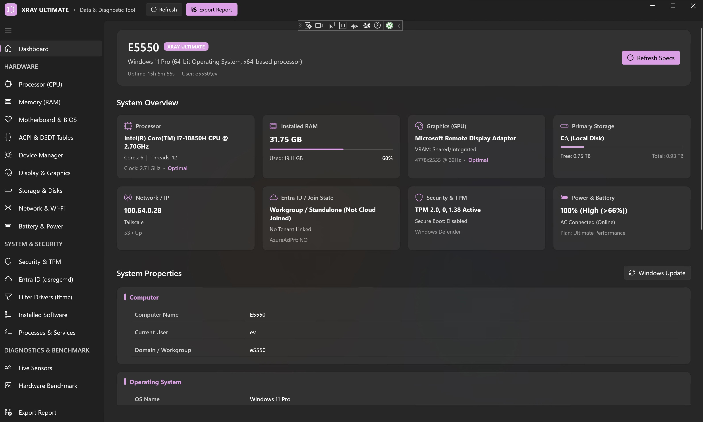

# XRAY ULTIMATE

[](https://www.microsoft.com/windows)
[](https://dotnet.microsoft.com/)
[](https://github.com/microsoft/microsoft-ui-xaml)
[](https://github.com/dmitryporotnikov/XRAY-ULTIMATE/releases)
[](https://github.com/dmitryporotnikov/XRAY-ULTIMATE/actions/workflows/release.yml)

XRAY ULTIMATE is a Windows desktop app that shows what the machine is actually made of. CPU caches and instruction sets, DIMM slots and their serials, ACPI tables read straight out of firmware memory, TPM state, GPU temperatures. It runs on .NET 10 with WinUI 3, asks for administrator rights at launch, and can dump the whole picture into HTML, JSON, or plain text when you need to hand it to someone.

It's built for the support call where Task Manager and `msinfo32` stop being enough.



## What it reads

Hardware: CPU microarchitecture, L1/L2/L3, AVX-512/AVX2/SSE4.2/AES-NI and VT-x with Hyper-V detection; SMBIOS DIMM slots with DDR generation, locator, serial, rated speed and manufacturer; NVMe and SATA drives with SMART data; WDDM adapters, VRAM, resolutions and monitors, plus temperature, fan speed and power draw from `nvidia-smi`; adapters with IPv4, IPv6, gateways, DNS, DHCP, MAC and link speed, and live Wi-Fi SSID, channel and rates.

Firmware and security: ACPI and DSDT tables pulled with `GetSystemFirmwareTable` and decompiled into compilable ASL; TPM 2.0 presence checks, Secure Boot, BitLocker encryption method and registered antivirus; filesystem minifilters and NDIS filter drivers with altitudes; Entra ID join state parsed from `dsregcmd /status`.

System: the PnP device tree grouped across 29 classes, with driver services and Windows error codes; processes with whole-tree termination; services you can start, stop, restart or change startup type for; 32 and 64 bit installed software with CSV export; live CPU, memory, disk and network meters at 500 ms to 2 s sampling; a benchmark for multi-core compute, memory bandwidth and latency; and an audit export into interactive HTML, JSON for CMDB/SIEM, or plain text and Markdown.

More screenshots: [ACPI explorer](Documentation/screens/screen2.jpg), [driver filters](Documentation/screens/screen3.jpg).

## Requirements

Windows 10 version 1809 (build 17763) or newer, Windows 11 21H2 through 24H2, x64 only. Administrator rights are required: kernel firmware tables and most of the device queries won't answer without them.

## Install

Grab the MSI or the portable ZIP from [releases](https://github.com/dmitryporotnikov/XRAY-ULTIMATE/releases). The release workflow builds both on every push to `main`.

## Build

You need the [.NET 10 SDK](https://dotnet.microsoft.com/) and Visual Studio 2022 or 2025 with the Windows App SDK C# tools workload installed.

```powershell
dotnet build -p:Platform=x64
```

The binary lands in `bin\x64\Debug\net10.0-windows10.0.19041.0\win-x64\XRAY ULTIMATE.exe`.

## Documentation

- [Architecture and runtime model](Documentation/Architecture.md)
- [Hardware and telemetry collectors](Documentation/DataCollectors.md)
- [ACPI and DSDT decompiler](Documentation/AcpiDecompiler.md)
- [Audit export engine](Documentation/ExportEngine.md)
- [UI design system](Documentation/UI-Design-System.md)
- [Agent guidelines](AGENTS.MD)

## License

There's no license file in this repository yet, so treat the code as all rights reserved.
